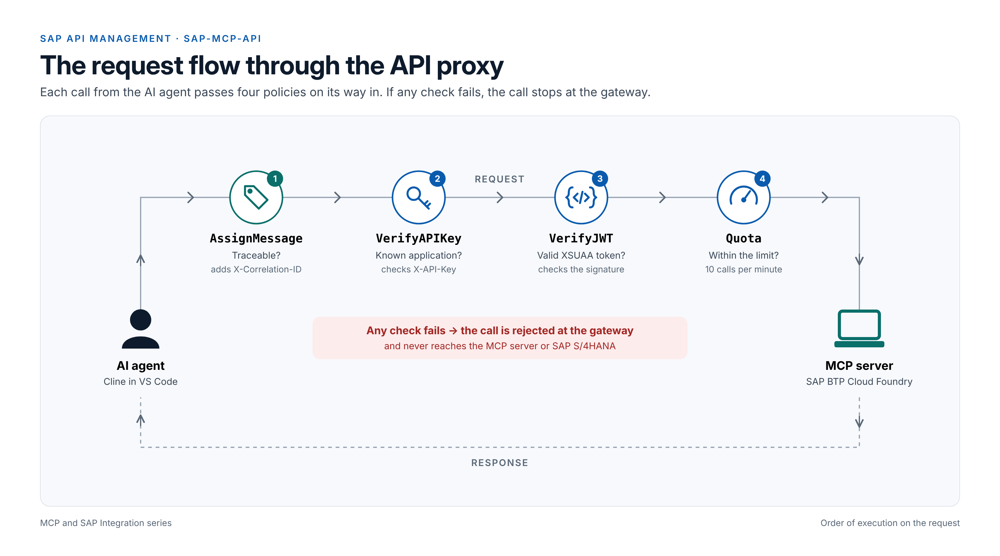

# SAP MCP Server on SAP BTP Cloud Foundry

## Which version do I need?

Each blog post has its own frozen version of the code. Pick the one that matches the post you are reading.

| Blog post | What you build | Code |
|---|---|---|
| [Part 1: Connecting AI Agents with Enterprise APIs](https://community.sap.com/t5/enterprise-resource-planning-blog-posts-by-members/mcp-and-sap-integration-connecting-ai-agents-with-enterprise-apis/ba-p/14471218) | Concepts only, no code | - |
| [Part 2: From Concept to Practice](https://community.sap.com/t5/enterprise-resource-planning-blog-posts-by-members/mcp-and-sap-integration-from-concept-to-practice-part-2/ba-p/14499849) | MCP server on Cloud Foundry, SAP API Management, Cline (sample data) | [Browse](https://github.com/himaniarya159-dev/sap-mcp-server/tree/part-2-apim) · [Download ZIP](https://github.com/himaniarya159-dev/sap-mcp-server/archive/refs/tags/part-2-apim.zip) |
| [Part 3: Live S/4HANA Data and Who Gets to Act](https://community.sap.com/t5/enterprise-resource-planning-blog-posts-by-members/mcp-and-sap-integration-part-3-live-s-4hana-data-and-who-gets-to-act/ba-p/14504121) | Same server, reading live S/4HANA data through a BTP destination | [Browse](https://github.com/himaniarya159-dev/sap-mcp-server/tree/part-3-s4hana) · [Download ZIP](https://github.com/himaniarya159-dev/sap-mcp-server/archive/refs/tags/part-3-s4hana.zip) |
| Part 4: Who Gets to Act? (coming soon) | Token check in the server, read/write scopes, preview and confirm, read-back, audit log | [Browse](https://github.com/himaniarya159-dev/sap-mcp-server/tree/part-4-execution-authority) · [Download ZIP](https://github.com/himaniarya159-dev/sap-mcp-server/archive/refs/tags/part-4-execution-authority.zip) |

`main` always holds the latest version.

A practical, end-to-end example of building a **Model Context Protocol (MCP) server** in Node.js, deploying it to **SAP BTP Cloud Foundry**, securing it with **SAP API Management** (Integration Suite), and asking it questions in **plain language** through the AI agent **Cline**.

```
You (plain language)
   ▼
Cline (AI agent in VS Code)  or  MCP client
   │  X-API-Key + Authorization: Bearer <XSUAA JWT>
   ▼
SAP API Management ── AssignMessage → VerifyAPIKey → VerifyJWT → Quota
   ▼
Node.js MCP Server (BTP Cloud Foundry, Streamable HTTP)
   │  Part 4: validates the XSUAA token, checks the scope per tool, writes an audit log
   ▼
Read tools  (Orders.Read):  get_customer, find_customers, get_order_updates, list_orders
Write tools (Orders.Write): prepare_sales_order → confirm_sales_order (Part 4)
   ▼
Sample data (Part 2)  or  SAP S/4HANA via BTP destination (Part 3, 4)
```



---

## Repository structure

```
sap-mcp-server/
├── .clinerules/
│   └── sap-assistant.md            # Rules for Cline: use only MCP tools, answer in plain language, never confirm without a "yes"
├── apim/
│   └── AssignCorrelationId.xml     # API Management policy that adds X-Correlation-ID (Part 4)
├── docs/images/
│   └── apim-request-flow.png       # Request flow diagram
├── src/
│   ├── index.js                    # MCP server: token check, scope check per tool, audit log, sample data
│   ├── s4-tools.js                 # Tools for live SAP S/4HANA via a BTP destination (Part 3) + write tools (Part 4)
│   ├── test-client.js              # Local test client
│   ├── apim-client.js              # MCP client calling the server through SAP API Management
│   └── get-token.js                # Prints an XSUAA token as "Bearer <token>" (for Cline)
├── cline-mcp-settings.example.json # Example Cline MCP settings (no real keys)
├── manifest.yml                    # Cloud Foundry deployment descriptor
├── xs-security.json                # XSUAA scopes Orders.Read and Orders.Write (Part 4)
├── .gitignore
├── .cfignore
└── package.json
```

## Stages and versions

The blog series builds the project in stages. Each blog post has its own **Git tag**, so you always get exactly the code the post describes. `main` holds the latest version.

| Stage | What you build | Blog post | Code |
|---|---|---|---|
| 1 | Local MCP server over **stdio** | Part 2 | tag **`v1-local-stdio`** |
| 2 | **HTTP** MCP server, tested locally | Part 2 | tag **`part-2-apim`** |
| 3 | Deploy to SAP BTP Cloud Foundry | Part 2 | tag **`part-2-apim`** |
| 4 | Secure with SAP API Management + MCP client | Part 2 | tag **`part-2-apim`** |
| 5a | Ask in plain language with **Cline**, local server | Part 2 | tag **`part-2-apim`** |
| 5b | Same questions with **Cline through SAP API Management** | Part 2 | tag **`part-2-apim`** |
| 6 | **Live SAP S/4HANA data** through a BTP destination | Part 3 | tag **`part-3-s4hana`** |
| 7 | **Execution authority:** token and scope checks, preview and confirm, read-back, audit log | Part 4 | tag **`part-4-execution-authority`** |

Switch to a version with `git checkout <tag>`, for example `git checkout part-2-apim`, then run `npm install`. Go back to the latest version with `git checkout main`.

---

## Prerequisites

- SAP BTP Trial account with the Cloud Foundry environment enabled
- Node.js 20.6+ (developed with v24)
- Cloud Foundry CLI
- SAP Integration Suite with **API Management** activated (Stage 4)
- VS Code with the **Cline** extension (Stage 5)
- A free [SAP Business Accelerator Hub](https://api.sap.com) account (Stage 6)

```bash
git clone https://github.com/himaniarya159-dev/sap-mcp-server.git
cd sap-mcp-server
```

---

## Scenario: customers and their sales orders

Stages 1 to 5 use this sample data:

| Customer | Orders |
|---|---|
| 1001 ABC Manufacturing (Calgary, Canada) | 1101 Shipped · 1102 In Process |
| 1002 XYZ Technologies (Austin, US) | 1103 Delayed (supplier shortage) |
| 1003 Global Retail GmbH (Hamburg, Germany) | 1104 Delivered and invoiced |
| 1004 Sunrise Foods Ltd (Pune, India) | 1105 On Hold (credit limit) |
| 1005 Northern Energy Inc (Edmonton, Canada) | 1106 Open |

| Tool | What it returns |
|---|---|
| `get_customer` | Customer details plus a summary of all their orders |
| `find_customers` | Customers by (part of) name and/or country |
| `get_order_updates` | Customer, status, items, total, dated update history, expected delivery |
| `list_orders` | Orders filtered by customer and/or status |

Each tool is defined once in a small registry in `src/index.js`, so adding a tool means adding one block. Stage 6 keeps the same tool names and reads live SAP S/4HANA data instead.

---

## Stage 1: Local MCP server (stdio)

Switch to the Stage 1 version:

```bash
git checkout v1-local-stdio
npm install
node src/test-client.js
```

The test client starts `src/index.js` as a local process and calls `get_customer` with ID `1001`:

```json
{ "customerId": "1001", "name": "ABC Manufacturing", "country": "Canada" }
```

When you're done, go back to the latest version:

```bash
git checkout main
npm install
```

## Stage 2: HTTP MCP server (local)

From here on, `src/index.js` is an HTTP server using the Streamable HTTP transport.

Terminal 1:

```bash
npm start
```

Terminal 2:

```bash
node src/test-client.js
```

- Health: `http://localhost:3000/health`
- MCP endpoint: `http://localhost:3000/mcp`

## Stage 3: Deploy to SAP BTP Cloud Foundry

1. Edit `manifest.yml` and change the route hostname to something unique.
2. Deploy:

```bash
cf login -a https://api.cf.<region>.hana.ondemand.com
cf target -o <your-org> -s <your-space>
cf push
```

> **Trial note:** Cloud Foundry apps on a trial account are stopped every night. Run `cf start sap-mcp-server` if you get `404 Requested route does not exist`.

> **Part 3 note:** on `main` and tag `part-3-s4hana`, `manifest.yml` binds the `mcp-destination` service. If you follow Part 2 only, use tag `part-2-apim`, or create that service first (Stage 6).

## Stage 4: Secure with SAP API Management

1. **API proxy:** Integration Suite → Configure → APIs → Create, with the Cloud Foundry `/mcp` URL as the target.
2. **Policies** in ProxyEndpoint → PreFlow, in this order:
   - **VerifyAPIKey:** `<APIKey ref="request.header.X-API-Key"/>`
   - **VerifyJWT:** RS256, `PublicKey/Value` = the `verificationkey` from your XSUAA service key, `Issuer` = `<xsuaa-url>/oauth/token`
   - **Quota:** for example 10 calls per minute per application (`Identifier ref="client_id"`)
3. **Product and application:** Engage → Products (publish), then subscribe in the Developer Hub to get the API key.
4. **XSUAA:** create an XSUAA instance and service key for the client credentials token.

Create a file named `.env` in the project root. It's excluded from Git and Cloud Foundry. Use single quotes around the values, and keep each value on one line:

```
APIM_URL='https://<your-apim-host>/<your-org>/sap-mcp'
APIM_API_KEY='<api key from Developer Hub application>'
XSUAA_URL='https://<subdomain>.authentication.<region>.hana.ondemand.com'
XSUAA_CLIENT_ID='<clientid from XSUAA service key>'
XSUAA_CLIENT_SECRET='<clientsecret from XSUAA service key>'
```

Run:

```bash
node --env-file=.env src/apim-client.js 1101
```

Expected output:

```
Connected to MCP server via SAP API Management
Discovered tools: [ 'get_customer', 'find_customers', 'get_order_updates', 'list_orders' ]
Customers in Canada: [ ABC Manufacturing, Northern Energy Inc ]
Order 1101: { "orderId": "1101", "status": "Shipped", ... }
```

### Expected security behaviour

| Request | Result |
|---|---|
| API key + JWT | `200` |
| JWT only | `401` `steps.oauth.v2.FailedToResolveAPIKey` |
| API key only | `401` `steps.jwt.FailedToResolveVariable` |
| Over the quota | `500` `policies.ratelimit.QuotaViolation` |

New tools added to the server need **no change in API Management**: the proxy forwards all MCP traffic to `/mcp`, so every tool is protected by the same three policies.

---

## Stage 5: Ask in plain language with Cline

[Cline](https://cline.bot) is an open-source AI agent for VS Code. It connects to this MCP server, discovers the tools through `tools/list`, chooses the right tool for a question and answers in plain language. The server needs no LLM key: the model is configured in Cline.

```
You (plain language) → Cline (LLM) → tools/call → MCP server → Cline (plain language)
```

### 5a · Cline with the local server

1. Start the server: `npm start` (the log ends with `Tools: get_customer, find_customers, get_order_updates, list_orders`).
2. VS Code → install the **Cline** extension → sign in. The free model is enough.
3. Cline → **wrench icon → MCP → Installed → Edit Configuration**, add the `sap-mcp-local` entry from [`cline-mcp-settings.example.json`](cline-mcp-settings.example.json) and save:

   ```json
   {
     "mcpServers": {
       "sap-mcp-local": {
         "type": "streamableHttp",
         "url": "http://localhost:3000/mcp",
         "disabled": false,
         "autoApprove": []
       }
     }
   }
   ```

4. `sap-mcp-local` turns green. Expand it with **›** to see the same 4 tools the server printed.

The file [`.clinerules/sap-assistant.md`](.clinerules/sap-assistant.md) is loaded by Cline automatically when this folder is open in VS Code. It tells Cline to use only the MCP tools (not the project files), never invent data, and answer in a fixed, human-readable pattern.

### Try it

Type the question in the Cline chat (Act mode):

| Question | Tool(s) Cline calls |
|---|---|
| Please give me all updates of order no 1101 | `get_order_updates` |
| Which orders does ABC Manufacturing have? | `find_customers` → `list_orders` |
| Why is order 1103 delayed and when will it arrive? | `get_order_updates` |
| Which orders are on hold or delayed? | `list_orders` |
| Show me the details of order 9999 | `get_order_updates` → "not found" (no invented answer) |

Example answer for order 1103:

> **Order 1103** belongs to **XYZ Technologies** (Austin, United States) and is currently **Delayed**.
> - **20 Sep 2026** – Order created
> - **21 Sep 2026** – Order confirmed: original delivery date 30 Sep 2026
> - **28 Sep 2026** – Delayed: supplier shortage of Control Unit C-9; new delivery date 12 Oct 2026
>
> **Items:** Control Unit C-9 – 2. **Total:** 8,300.00 USD. **Expected delivery:** 12 Oct 2026.

Turn off **Auto-approve → MCP** in Cline if you want to approve each tool call and see the tool name and arguments first.

### 5b · Cline through SAP API Management

Now every question passes VerifyAPIKey → VerifyJWT → Quota before it reaches the server on Cloud Foundry.

1. Make sure the app is running (`cf app sap-mcp-server`, otherwise `cf start sap-mcp-server`) and `.env` is filled in (Stage 4).
2. Get a token. It is printed as `Bearer <token>` and copied to the clipboard:

   ```powershell
   node --env-file=.env src/get-token.js | Set-Clipboard
   ```

3. Cline → **Edit Configuration**. Disable `sap-mcp-local` and add `sap-mcp-apim`:

   ```json
   {
     "mcpServers": {
       "sap-mcp-local": {
         "type": "streamableHttp",
         "url": "http://localhost:3000/mcp",
         "disabled": true,
         "autoApprove": []
       },
       "sap-mcp-apim": {
         "type": "streamableHttp",
         "url": "https://<apim-host>/<org>/sap-mcp",
         "headers": {
           "X-API-Key": "<APIM_API_KEY from .env>",
           "Authorization": "<paste: Bearer eyJ...>"
         },
         "disabled": false,
         "autoApprove": []
       }
     }
   }
   ```

4. Save. `sap-mcp-apim` turns green with 4 tools.
5. Stop the local server (Ctrl + C), so the answer can only come through API Management. Start a **new** task in Cline and ask the same questions. The tool call in the chat names `sap-mcp-apim`.
6. Optional: Integration Suite → Configure → APIs → SAP-MCP-API → **Debug** shows every policy for each request from Cline.

| Header | Value | Not this |
|---|---|---|
| `X-API-Key` | Application **Key** from the Developer Hub | the application secret |
| `Authorization` | `Bearer ` + access token (`eyJ…`) from `get-token.js` | the `verificationkey` (`MIIB…`) – that belongs only in the VerifyJWT policy |

Notes:

- The token expires (about 12 hours). When `sap-mcp-apim` turns red with 401, run `get-token.js` again and paste the new value.
- One Cline question sends several requests (`initialize`, `tools/list`, `tools/call`). With a quota of 10 per minute, a few quick questions show the quota violation in the chat. Raise the limits for normal use.
- Your real Cline settings live in Cline's own settings file, outside this repo. Never commit them.

---

## Stage 6: Live SAP S/4HANA data via a BTP destination (Part 3)

Code for this stage: tag `part-3-s4hana`. Tools, Cline and SAP API Management stay the same. Only the data source changes.

1. **Get a sandbox API key:** log on at [api.sap.com](https://api.sap.com), open *Sales Order (A2X)* and click **Show API Key**.
2. **Create a BTP destination** (Connectivity → Destinations):

   | Field | Value |
   |---|---|
   | Name | `S4HANA_SANDBOX` |
   | URL | `https://sandbox.api.sap.com/s4hanacloud` |
   | Proxy Type | Internet |
   | Authentication | NoAuthentication |
   | Additional property | `URL.headers.APIKey` = your sandbox key |

   Click **Check Connection**. It should report that the HTTP request succeeded.

3. **Create the Destination service and deploy:**

   ```bash
   cf create-service destination lite mcp-destination
   npm install
   cf push
   ```

   `manifest.yml` binds `mcp-destination` and sets `DATA_SOURCE: s4`.

4. **Check:** `https://<your-app-route>/health` returns `"dataSource":"s4"`.
5. **Ask Cline** (through `sap-mcp-apim`, as in Stage 5b):

   | Question | Expected answer |
   |---|---|
   | Please give me all updates of order no 7 | Open, 50.70 USD, customer 17100001, `source: SAP S/4HANA (live)` |
   | Show me order 14 | Completed, 70,200.00 USD, customer USCU-CUS01 |
   | List open orders for customer USCU-CUS21 | A list of open orders (at most 20) |
   | Give me updates of order 5 | Not found, no invented answer |

Running `npm start` locally still uses the sample data, because `DATA_SOURCE` is only set in `manifest.yml`.

Tool errors come back in a structured form, so the agent knows whether a retry makes sense:

| Error | Retryable |
|---|---|
| `TEMPORARY_ERROR` (HTTP 429, 5xx, timeout) | yes |
| `NOT_FOUND` (HTTP 404) | no |
| `REQUEST_ERROR` (HTTP 400/401/403 or a bad request) | no |
| `CONFIGURATION_ERROR` (destination not found) | no |

---

## Stage 7: Who Gets to Act? (Part 4)

Code for this stage: tag `part-4-execution-authority`. Part 3 showed that an agent *can* reach SAP. This stage decides what it is *allowed* to do, and proves what actually happened.

| Question | Answer in this stage |
|---|---|
| Who may call the server? | The server validates the XSUAA token itself. Calls to the Cloud Foundry URL without a valid token get `401`. |
| Who may run which tool? | Every tool declares a scope. Read tools need `Orders.Read`, write tools need `Orders.Write`. Missing scope → `NOT_AUTHORIZED`. |
| Who approves a write? | A human. `prepare_sales_order` only shows a preview. The order is created only after the user says "yes" and `confirm_sales_order` runs. |
| What if the agent retries? | `confirm_sales_order` is idempotent: confirming the same order twice never creates a second order. |
| What confirms the business outcome? | After creating the order, the server reads it back and returns what the system holds, with `verified: true`. |
| Can we trace it later? | Every tool call writes an `AUDIT` log line with time, correlation ID, client, tool, scope, decision and outcome. |

### 7.1 Scopes in XSUAA

`xs-security.json` defines two scopes. `authorities` decides which scopes the client-credentials token gets:

```json
{
  "xsappname": "<your-xsappname>",
  "tenant-mode": "shared",
  "scopes": [
    { "name": "$XSAPPNAME.Orders.Read",  "description": "Read customers and sales orders" },
    { "name": "$XSAPPNAME.Orders.Write", "description": "Prepare and create sales orders" }
  ],
  "authorities": [ "$XSAPPNAME.Orders.Read", "$XSAPPNAME.Orders.Write" ]
}
```

To see a refusal first, start with only `Orders.Read` in `authorities`, then add `Orders.Write` later. Apply the file to the XSUAA instance, which is bound to the app in `manifest.yml`:

```bash
cf update-service mcp-xsuaa -c xs-security.json
cf push
```

Then get a **new** token (`get-token.js`), because scopes are written into the token when it is issued. Check which scopes the token holds:

```powershell
$token = (node --env-file=.env src\get-token.js | Select-Object -First 1)
$p = $token.Split('.')[1].Replace('-','+').Replace('_','/'); while ($p.Length % 4) { $p += '=' }
([Text.Encoding]::UTF8.GetString([Convert]::FromBase64String($p)) | ConvertFrom-Json).scope
```

### 7.2 Token check in the server

On Cloud Foundry (`NODE_ENV=production`) every request to `/mcp` needs a valid XSUAA token. The server validates it with `@sap/xssec`, so even a direct call to the Cloud Foundry URL, which skips API Management, is rejected:

```powershell
# Without a token -> 401
curl.exe -i -X POST "https://<your-app-route>/mcp" -H "Content-Type: application/json" -H "Accept: application/json, text/event-stream" -d '{\"jsonrpc\":\"2.0\",\"id\":1,\"method\":\"tools/list\"}'

# With a token -> 200
curl.exe -s -o NUL -w "%{http_code}" -X POST "https://<your-app-route>/mcp" -H "Content-Type: application/json" -H "Accept: application/json, text/event-stream" -H "Authorization: $token" -d '{\"jsonrpc\":\"2.0\",\"id\":1,\"method\":\"tools/list\"}'
```

The log shows `Token check: ON (XSUAA)` after the app starts.

### 7.3 Preview, confirm and read-back

Ask Cline: *Create a sales order for customer 17100001: 3 pieces of material TG13.*

1. Cline calls `prepare_sales_order`. Nothing is created. The answer is a preview (customer, material, quantity, sales area 1710/10/00) and a confirmation ID that expires after 5 minutes.
2. You reply **yes**. Cline calls `confirm_sales_order` with the confirmation ID.
3. The server creates the order, **reads it back** and returns what the system holds:

```json
{ "salesOrder": "SIM0000001", "customer": "17100001", "material": "TG13", "quantity": "3 PC", "status": "Open", "verified": true, "mode": "simulated - the SAP Business Accelerator Hub sandbox does not save new orders" }
```

4. Ask *Please confirm that order again*. The same confirmation ID returns the same order with the note *Already created earlier. No second order was created.*

**Simulated vs. live:** the SAP Business Accelerator Hub sandbox does not save new orders, so by default the server simulates the save (numbers `SIM0000001`, `SIM0000002`, …) and reads back from its own store. With a real S/4HANA system, set `WRITE_MODE: live` in `manifest.yml`. The server then POSTs to `A_SalesOrder` and reads the order back from SAP.

`.clinerules/sap-assistant.md` tells Cline to always prepare first, never confirm without the user's "yes", and to report whether the result is verified and simulated. Keep **Auto-approve** for MCP tools turned off in Cline.

### 7.4 Refusal without the Write scope

With only `Orders.Read` in the token, `prepare_sales_order` returns:

```json
{ "error": "NOT_AUTHORIZED", "retryable": false, "message": "This client is not allowed to run prepare_sales_order. Required scope: Orders.Write." }
```

The agent sees that a retry makes no sense and explains the refusal instead.

### 7.5 Audit log and correlation ID

```powershell
cf logs sap-mcp-server | Select-String "AUDIT"
```

```
AUDIT {"time":"…","correlationId":"…","client":"sb-na-…","tool":"confirm_sales_order","scope":"Orders.Write","decision":"allowed","outcome":"created SIM0000001","ms":11}
```

Add the policy in [`apim/AssignCorrelationId.xml`](apim/AssignCorrelationId.xml) as the **first** policy in ProxyEndpoint → PreFlow. It sets `X-Correlation-ID` to the API Management message ID, so one ID links the API Management Debug view and the server's AUDIT line.

### Known limits of this stage

- **Per application, not per user:** client-credentials tokens carry the scopes of the application. Per-user rights need a user token (for example with principal propagation).
- **Simulated writes:** the sandbox can't save orders.
- **In-memory state:** pending confirmations and simulated orders are lost when the app restarts.
- **Human approval relies on the client:** the server enforces preview → confirm, but the "yes" is collected by the agent.
- **Direct calls with a valid token** still reach the Cloud Foundry URL without the API key and quota. Route production traffic only through API Management.

## Troubleshooting

| Problem | Fix |
|---|---|
| `404 Requested route … does not exist` | Trial app is stopped: `cf start sap-mcp-server` |
| Deployment error `Invalid Public Key Value … policy(VerifyJWT)` | Remove unused policies from **Created Policies**, not only from the flow |
| Token request fails in PowerShell | Put the client secret in **single quotes**, because XSUAA secrets can contain `$` |
| `.env: not found` | Create `.env` in the project root (not in `src`), saved as ASCII/UTF-8 |
| `Failed to parse URL from undefined/oauth/token` | Run with `node --env-file=.env src/get-token.js` from the project root |
| Quota allows a few extra calls | Distributed quota counters sync asynchronously, which is expected |
| `listen EADDRINUSE :3000` | An old server is still running: `netstat -ano \| findstr :3000`, then `Stop-Process -Id <PID> -Force` |
| Cline shows the server in red | Start `node src/index.js`, then click restart on the server in Cline's MCP view |
| Cline shows old tools | Restart the server and click restart (⟳) on the server in Cline |
| Cline answers from the code instead of calling tools | Make sure `.clinerules/sap-assistant.md` is in the project root and the project folder is open |
| Cline: `Headers.append … is an invalid header value` | The public key (`MIIB…`) was pasted as a header. Use the API key and `Bearer <token>` |
| Cline: "Invalid JSON" after pasting the token | The token was copied from the terminal, where it wraps over several lines. Use `get-token.js \| Set-Clipboard` |
| `sap-mcp-apim` red with 401 | Token expired or wrong API key: run `get-token.js` again |
| Cline: `/register` or `ApplicationNotFound` error | The first call failed (usually a wrong or broken proxy URL), so Cline fell back to OAuth. Check the URL is on one line |
| `Invalid ApiKey` | The key is not the application **Key**, or the application is not subscribed to the product with this proxy |
| Token request failed: 401 | `XSUAA_URL`, client ID or secret in `.env` don't match your XSUAA service key |
| Stage 6: `"dataSource":"sample"` | `DATA_SOURCE: s4` is missing in `manifest.yml`, push again |
| Stage 6: `CONFIGURATION_ERROR` | `mcp-destination` is not bound, or the destination is not named `S4HANA_SANDBOX` |
| Stage 6: `REQUEST_ERROR (HTTP 401)` | The sandbox API key in the destination (`URL.headers.APIKey`) is wrong |
| Stage 7: `Cannot change tenant mode … from shared to dedicated` | Keep `"tenant-mode": "shared"` in `xs-security.json` |
| Stage 7: `NOT_AUTHORIZED` after adding `Orders.Write` | The old token is still in use. Run `get-token.js` again and update the `Authorization` header in Cline |
| Stage 7: `401 Unauthorized: a valid XSUAA token is required` | The token is missing or expired, or it was issued by another XSUAA instance |
| Stage 7: Cline still shows 4 tools | `cf push`, restart the server in Cline's MCP view and start a new task |
| `cf push` fails with `token expired` | `cf logout`, then `cf login --sso` |

---

## Security notes

- Never commit `.env`, service keys, API keys, or tokens.
- `cline-mcp-settings.example.json` contains placeholders only. Your real Cline settings live in Cline's own settings file.
- The sandbox API key lives only in the BTP destination, never in code.
- From Stage 7, the MCP server validates the XSUAA token itself, so calls to the Cloud Foundry URL without a token are rejected. A caller with a valid token can still skip the API key and quota, so route production traffic only through API Management.
- Writes are simulated by default. Use `WRITE_MODE: live` only with a test system you're allowed to change.

## Next steps

- User tokens instead of client credentials, so scopes follow the person, not the application
- Persistent storage for pending confirmations and the audit log
- Measure the token cost of each scenario (read, preview, confirm)
- Connect the same MCP server to a **Joule agent** through a BTP destination
